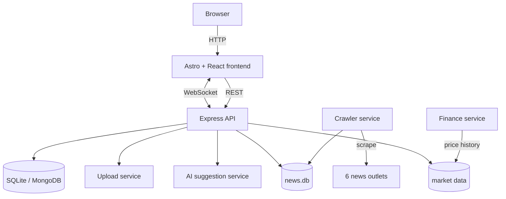

# FinSavvy — Stock Tracking & Financial News Platform

> Full-stack platform that tracks Vietnamese stock prices in real time, aggregates financial news from 6 major outlets, and lets users follow stocks, discuss in comments, and get AI-powered investment suggestions.

<!-- Thêm link demo + ảnh chụp màn hình ở đây. Ảnh là thứ đầu tiên người ta nhìn. -->

🔗 **Live demo:** `https://YOUR-DEMO-URL`
🎬 **Video demo (2 phút):** `https://YOUR-VIDEO-URL`


## Features

- 📈 **Real-time stock board** — price updates over WebSocket, watchlist per user
- 📰 **News aggregator** — crawler for CafeF, VnExpress, Tuoi Tre, VietnamNet, VietnamBiz, VnEconomy
- 🤖 **AI investment suggestions** — sentiment/suggestion layer on top of news and price history
- ✍️ **Blog & comments** — Markdown editor, threaded comments, author pages, follow
- 🔐 **Auth** — register, login, forgot/reset password, JWT
- 🔔 **Price alerts** — scheduled job checks thresholds and notifies the user
- 🌓 Dark/light theme, responsive UI

## Architecture



The backend runs three cooperating services (managed by `concurrently`):
| Service | Responsibility |
|---|---|
| `services/api` | REST API, auth, blog, comments, watchlist, WebSocket |
| `services/crawler` | Scrapes and normalizes news from 6 sources |
| `services/finance` | Stock symbol/price data and history |

## Tech stack

**Frontend** — Astro 6, React 19, React Query, Tailwind 4, Recharts, Framer Motion
**Backend** — Node.js, Express 5, JWT, Multer, WebSocket (`ws`), node-cron
**Data** — SQLite, MongoDB (Mongoose), Supabase storage
**Tooling** — pnpm workspace, Prettier

## My contribution

> Team of 2. Điền chính xác phần bạn làm — nhà tuyển dụng đọc dòng này kỹ nhất.

- Designed and implemented the **crawler pipeline** (fetcher, per-site extractors, RSS fallback, deduplication)
- Built the **real-time stock board** (WebSocket manager + React hook `useStockSocket`)
- Implemented **watchlist** + **price alert cron**
- Built the **blog module** (Markdown editor, comment threads, author pages)
- Set up the frontend design system (`base-ui` components, theme toggle)

## Getting started

### Prerequisites

Node.js 20+, pnpm 9+

### 1. Backend

```bash
cd backend
pnpm install
cp services/api/.env.example "services/api/.env"   # điền biến môi trường
pnpm run seed        # tạo dữ liệu mẫu
pnpm start           # chạy API + finance + crawler
```

### 2. Frontend

```bash
cd frontend
pnpm install
pnpm dev             # http://localhost:4321
```

### Environment variables

Xem `backend/services/api/.env.example`.

| Variable                       | Mô tả              |
| ------------------------------ | ------------------ |
| `PORT`                         | cổng API           |
| `JWT_SECRET`                   | khoá ký JWT        |
| `EMAIL`, `PASS`                | tài khoản gửi mail |
| `SUPABASE_URL`, `SUPABASE_KEY` | lưu file upload    |

## What I learned

- Thiết kế pipeline crawl nhiều nguồn có cấu trúc khác nhau, chuẩn hoá về một schema chung
- Giữ WebSocket ổn định khi có nhiều client và reconnect
- Quản lý state phía client với React Query (cache, invalidate, optimistic update)
- Làm việc nhóm qua Git: chia nhánh, review, xử lý conflict

## Roadmap

- [ ] Docker Compose one-command startup
- [ ] Integration tests cho API (supertest + test DB)
- [ ] GitHub Actions CI
- [ ] Deploy public demo

## License

MIT
